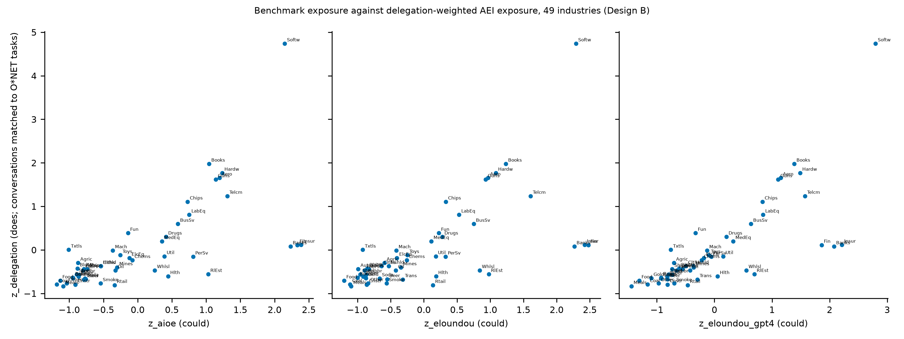

## What the index measures {.unnumbered .unlisted}

The Anthropic Economic Index (AEI) publishes how conversations with one provider's model spread across the tasks of the US O\*NET occupational database, and how each conversation divides the work: in an *automation* pattern the user hands the task over, and in an *augmentation* pattern the user works through it with the model. This paper calls the automation share *delegation*. It uses the releases from  to , links tasks to occupations and occupations to the  Fama–French industries, and tests hypotheses fixed in a protocol registered as  on . 

## Who delegates, and is it changing? (RQ1) {.unnumbered .unlisted}

The first hypothesis, that delegation is lower in occupations requiring more education or paying higher wages (H1), is : its null is not rejected at . Within task families the automation share differs by  percentage points per year of education (interval  to ), and the wage coefficient points the opposite way from the prediction without being significant at its level. Under the pre-registered robustness row R24 r5 the H1 test falls below its level, which changes no decision. The second, that delegation rises within the same task across releases (H2), is : the release-level condition fails (wild-bootstrap p = , level ), although the task-clustered trend is  percentage points per year (interval  to , p ). As context, that rise is one step between two releases, then a fall, at a change in how conversations were classified, so classifier or platform drift cannot be told apart from behaviour; the balanced comparison also leaves out  tasks holding  per cent of usage (descriptive). The third, that users check the model's work more where errors are costly (H3), is : its null is not rejected, and the estimate is  percentage points of the checking share (interval  to ). The fourth, that countries differ in delegation beyond the mix of tasks their users bring (H4), is : holding task mix fixed, the automation share differs by  percentage points per unit of the log (a hundred log points) of the Anthropic Usage Index, usage relative to working-age population (interval  to ). Usage and income are strongly correlated across countries, so their separate contributions are hard to tell apart, though the joint test is not.

## Could versus does (RQ2) {.unnumbered .unlisted}

RQ2 is descriptive and carries no test. Across the  industries, the rank correlation between delegation exposure and the human-rated theoretical exposure scores of Eloundou and co-authors is  (bootstrap interval  to ; @fig-rq2-could-vs-does). Both measures use the same occupation-to-industry employment weights, so part of the agreement is shared occupational mix. Occupations the index does not publish are assigned zero usage by assumption, not measured as zero; dropping them instead, in the pre-registered robustness row R3, lowers the correlation most. The employment weights () were published on , after the  formation date of the industry measures, as were the O\*NET  task links, so these are out of sample in AEI data only and not strictly real-time; the strict real-time row R32 is run for the market tests only.

::: {.content-visible when-meta="brief"}
::: {.content-visible when-format="pdf"}
{#fig-rq2-could-vs-does fig-alt="Scatter panels of the AIOE and Eloundou benchmark exposures against delegation exposure, one point per industry."}
:::
::: {.content-visible when-format="html"}
{#fig-rq2-could-vs-does fig-alt="Scatter panels of the AIOE and Eloundou benchmark exposures against delegation exposure, one point per industry."}
:::
:::

## Did markets price it? (RQ3) {.unnumbered .unlisted}

At  per cent power the main test's minimum detectable effect,  percentage points of annualised risk-adjusted return per standard deviation of exposure, exceeds rule D11's threshold of  points, confirmed with that effect in view, so the market evidence is reported as what it can and cannot yet say. For H5, that more delegation-exposed industries earned risk-adjusted returns departing from the historical pattern from  to , the fixed wording reads:  For H5b, that delegation exposure carries information beyond theoretical exposure, it reads:  Both decisions (H5 , H5b ) rest on employment weights published inside the return window and O\*NET links postdating formation, so these tests are out of sample in AEI data only and not strictly real-time; R32 is the strict real-time row and R1 is look-ahead.

## What this does not show {.unnumbered .unlisted}

The index records conversations on one provider's platforms, classified by an unstated method that may drift across releases; it does not sample people at work and says nothing about the prospects of any occupation. The associations are descriptive, not statements of what would follow if delegation changed. The market non-rejections do not show that exposure is unrelated to returns; their power clauses say what this short window could detect. Exploratory analyses, H6 among them, are not findings.
